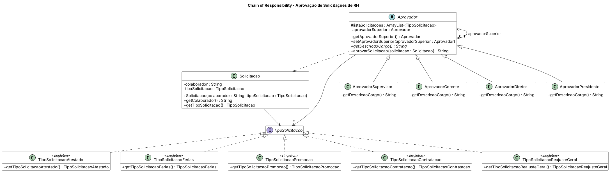

# Padrão Chain of Responsibility

Aplicação de **aprovação de solicitações de RH**. Cada solicitação (atestado, férias, promoção, contratação) percorre uma cadeia de aprovadores — Supervisor → Gerente → Diretor → Presidente. Cada aprovador sabe quais tipos pode aprovar; se não puder, repassa ao superior. Se ninguém na cadeia puder aprovar (ex.: reajuste geral), retorna "Sem aprovação".

## Diagrama de classes



O fonte do diagrama (PlantUML) está em `diagrama/diagrama-classes.puml`.

## Estrutura

- `src/main/java` — código-fonte
- `src/test/java` — casos de teste (JUnit 5)
- `diagrama/` — diagrama de classes

## Como executar os testes

```bash
mvn test
```

Ou abra o projeto no IntelliJ e rode a pasta `src/test/java`.

Java 11 · Maven · JUnit 5
